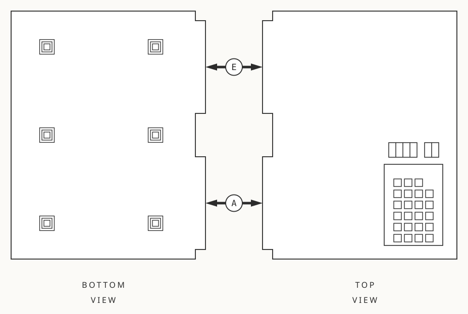
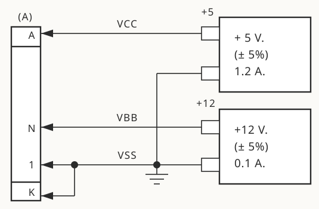
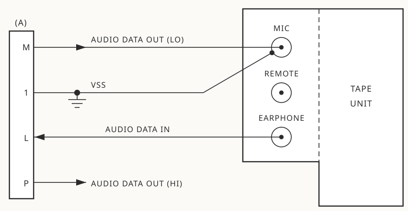
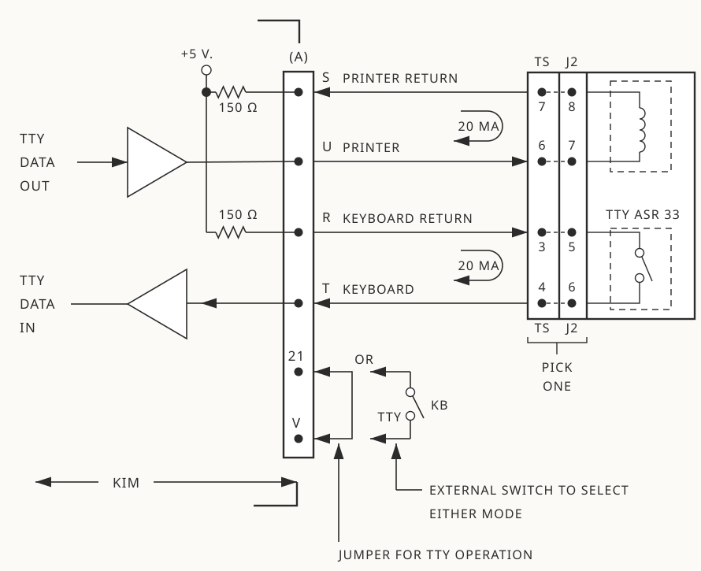

# Chapter 2 - Getting Started

This chapter is intended to guide you through the first important steps in achieving initial operation of your KIM-1 Microcomputer Module. We will ask you to perform certain operations without explanation at this time as to why they are being done. In later sections of this manual, full explanations will be offered for every operating procedure.

## Parts complement

After unpacking the shipping container for your KIM-1, you should have located the following items:

* 3 Books - [KIM-1 Users Manual](../kim-1-users-manual.md) 
    * Hardware Manual 
    * Programming Manual
* 1 Programming Card
* 1 System Schematic
* 1 KIM-1 Module 
* 1 Connector (Already mounted on the Module)
* 1 Hardware Packet 
* 1 Warranty Card

You may wish to save the shipping container and packing material should you need to return your KIM-1 module to us at some future date.

## A few words of caution

Your KIM-1 module includes a number of MOS integrated circuits. All such circuits include protective devices to prevent damage resulting from inadvertant application of high voltage potentials to the pins of the device. However, normal precautions should be taken to prevent the appli­ cation of high voltage static discharges to the pins of an MOS device.

Immediately before removal of the packing material from your KIM-1 module, you should develop the following precautionary habits:

1. Discharge any static charge build up on your body by touching a ground connection **before** touching any part of your KIM-1 module. (This precaution is especially important if you are working in a carpeted area)
2. Be certain that soldering irons or test equipment used on the KIM-1 module are properly grounded and not the source of dangerously high voltage levels.

On a different subject, after unpacking your KIM-1 module, you will note the presence of a potentiometer. This adjustment has been set at the factory to insure correct operation of the audio cassette interface circuits. It should **never** be necessary for you to change the position of this potentiometer.

## First Steps

After unpacking the KIM-1 module, locate the small hardware packet and install the rubber pads provided. The rubber pads are located at the bottom of the module (see attached sketch) and act both to lift the card  off your work surface and to provide mechanical support for the module while you depress keys.

Place the module such that the keyboard is to your lower right and observe that two connector locations extend from the module to your left. The connector area on the lower left is referred to as the Application connector (A) . You will note that a 44 pin board edge connector is already installed at this location. The connector area to the upper left is for use by you for future system expansion and is referred to as the Expansion connector (E).

<figure markdown="span">
  
  <figcaption>Figure 2.1 KIM-1 Module</figcaption>
</figure>

Remove the (A) connector from the module and connect the pins as shown in the sketch.

<figure markdown="span">
  
  <figcaption>Figure 2.2 Power Supply Connections</figcaption>
</figure>

Reinstall the (A) connector making certain that the orientation is correct.

Note 1: The +12 volt power supply is required only if you will be using an audio cassette recorder in your system. 
Note 2: The jumper from pin A-K to Vss (Pin A-l) is essential for system operation. If you expand your system later, this jumper will be removed and we'll tell you what to do to pin A-K.
Note 3: If you don't have the proper power supplies already available, you may wish to construct the low cost version shown with schematic and parts list in Appendix D. In any event, your power supply **must** be regulated to insure correct system operation and must be capable of supplying the required current levels indicated in the sketch.

Now, recheck your connections, turn on your power supplies, and depress <kbd>RS</kbd> (reset). You should see the LED display digits light as your first check that the system is operational. If not, recheck your hookup or refer to Appendix C (In Case of Trouble).

## Let's try a simple program

Assuming that you have completed successfully all of the steps thus far, a simple program now can be tried to demonstrate the operation of the system and increase your confidence that everything works properly. We'll be using only the keyboard and display on the module for this example. (In the next two sections we'll worry about the teleprinter and the audio cassette).

For our first example, we will add two 8 bit binary numbers together and display the result. We presume that you are familiar with the hex­ adecimal representation of numbers and the general rules for binary arith­metic.

First check and be sure that the slide switch in the upper right corner of the keyboard is pushed to the left (SST Mode is OFF). Now proceed with the following key sequence:

| Press Keys | See On Display | Step # |
|---|:---:|:---:|
| <kbd>AD </kbd>| <samp>xxxx xx</samp> | 1 |
| <kbd>0</kbd> <kbd>0</kbd> <kbd>0</kbd> <kbd>2</kbd> | <samp>0002 xx</samp> | 2 |
| <kbd>DA</kbd> | <samp>0002 xx</samp> | 3 |
| <kbd>1</kbd> <kbd>8</kbd> | <samp>0002 18</samp> | 4 |
| <kbd>+</kbd> <kbd>A</kbd> <kbd>5</kbd> | <samp>0003 A5</samp> | 5 |
| <kbd>+</kbd> <kbd>0</kbd> <kbd>0</kbd> | <samp>0004 00</samp> | 6 |
| <kbd>+</kbd> <kbd>6</kbd> <kbd>5</kbd> | <samp>0005 65</samp> | 7 |
| <kbd>+</kbd> <kbd>0</kbd> <kbd>1</kbd> | <samp>0006 01</samp> | 8 |
| <kbd>+</kbd> <kbd>8</kbd> <kbd>5</kbd> | <samp>0007 85</samp> | 9 |
| <kbd>+</kbd> <kbd>F</kbd> <kbd>A</kbd> | <samp>0008 FA</samp> | 10 |
| <kbd>+</kbd> <kbd>A</kbd> <kbd>9</kbd> | <samp>0009 A9</samp> | 11 |
| <kbd>+</kbd> <kbd>0</kbd> <kbd>0</kbd> | <samp>000A 00</samp> | 12 |
| <kbd>+</kbd> <kbd>8</kbd> <kbd>5</kbd> | <samp>000B 85</samp> | 13 |
| <kbd>+</kbd> <kbd>F</kbd> <kbd>B</kbd> | <samp>000C FB</samp> | 14 |
| <kbd>+</kbd> <kbd>4</kbd> <kbd>C</kbd> | <samp>000D 4C</samp> | 15 |
| <kbd>+</kbd> <kbd>4</kbd> <kbd>F</kbd> | <samp>000E 4F</samp> | 16 |
| <kbd>+</kbd> <kbd>1</kbd> <kbd>C</kbd> | <samp>000F 1C</samp> | 17 |

What you have just done is entered a program and stored it in the RAM at locations <code class="HEX">0x0002</code> through <code class="HEX">0x000F</code>. You should have noticed the purpose of several special keys on your keyboard:

| Key | Function |
|------|--------------------------------|
| <kbd>AD</kbd> | Selects the address entry mode |
| <kbd>DA</kbd> | Selects the data entry mode |
| <kbd>+</kbd> | Increments the address without changing the entry mode |
| <kbd>0</kbd> to <kbd>F</kbd> | 16 entry keys defining the hex code for address or data entry |

You've noticed as well that your display contains 6 digits. The four on the left are used to display the hex code for an address, the two on the right show the hex code for the data stored at the address shown. Therefore, when you pressed <kbd>AD</kbd> (step 1) and <kbd>0</kbd> <kbd>0</kbd> <kbd>0</kbd> <kbd>2</kbd> (step 2), you defined the address entry mode, selected the address <code class="HEX">0x0002</code>, and displayed the address <code class="HEX">0x0002</code> in the four left-most display digits. Incidentally, when we show an "x" in the display chart, we mean that we don't know what will be displayed and we "don't care."

Next you pressed <kbd>DA</kbd> (step 3) followed by <kbd>1</kbd> <kbd>8</kbd> (step 4). Here, you have defined the data entry mode and entered the value 18 to be stored at your selected address <code class="HEX">0x0002</code>. Of course, the 18 then was dis­played in the two right-most digits of your display.

You remained in the data entry mode but began to press  followed by a two digit number (steps 5 to 17). Note that each depression of the <kbd>+</kbd> key caused the address displayed to increase by one. The hex keys following the <kbd>+</kbd> key continued to enter the data field of the display. This procedure is merely a convenience when a number of successive address locations are to be filled.

If you made any mistakes in pressing the keys, you should have noticed that correcting an error is simply a matter of reentering the data until 
the correct numbers show on the display.

The program you have entered is a simple loop to add two 8 bit binary numbers together and present the result on the display. For a programmer, the listing of the program entered might appear as follows:

```asm
POINTL				= $FA
POINTH				= $FB
START				= $1C4F
0000				VAL1
0001				VAL2
0002		18 		PROG		CLC
0003		A5 00			    LDA VAL1
0005		65 01			    ADC VAL2
0007		85 FA			    STA POINTL
0009		A9 00			    LDA #00
000B		85 FB			    STA POINTH
000D		4C 4F 1C			JMP START
```
Stated in simple terms, the program will clear the carry flag (CLC), load VAL1 into the accumulator (LDA VAL1), add with carry VAL2 to the accumulator (ADC VAL2), and store the result in a location POINTL (STA POINTL). A zero value is stored in a location POINTH (LDA #00 and STA POINTH) and the program jumps to a point labelled START (JMP START). This pre-stored program will cause the display to be activated and will cause the address field of your display to show the numbers stored in locations POINTH and POINTL. Note that the result of the addition has already been stored in location POINTL.

The hex codes appearing next to the address field of the listing are exactly the numbers you entered to store the program. We refer to these as machine language codes. For example, 4C is the hex code for the JMP instruction of the microprocessor. The next two bytes of the program define <code class="HEX">0x1C4F</code> (START) as the jump address.

As yet, you are not able to run the program because you have not yet entered the two variables (VAL1 and VAL2). Lets try an actual example:

| Press Keys | See On Display | Step # |
|---|:---:|:---:|
| <kbd>AD </kbd>| <samp>000F 1C</samp> | 17A |
| <kbd>0</kbd> <kbd>0</kbd> <kbd>F</kbd> <kbd>1</kbd> | <samp>00F1 xx</samp> | 17B |
| <kbd>DA</kbd> <kbd>0</kbd> <kbd>0</kbd> | <samp>00F1 00</samp> | 18 |
| <kbd>AD</kbd> | <samp>00F1 00</samp> | 19 |
| <kbd>0</kbd> <kbd>0</kbd> <kbd>0</kbd> <kbd>0</kbd> | <samp>0000 xx</samp> | 20 |
| <kbd>DA</kbd> <kbd>0</kbd> <kbd>2</kbd> | <samp>0000 02</samp> | 21 |
| <kbd>+</kbd> <kbd>0</kbd> <kbd>3</kbd> | <samp>0001 03</samp> | 22 |
| <kbd>+</kbd> <kbd>GO</kbd> | <samp>0002 18</samp> | 23 |

Steps 17A, 17B, and 18 insure that the binary arithmetic mode is selected.

Steps 19 to 21 store the hex value 02 in location <code class="HEX">0x0000</code> (VAL1). Step 22 stores the hex value 03 in location <code class="HEX">0x0001</code> (VAL2). Now we are ready to run the program. In step 23, the F°1 key causes the program to execute and the result, 05, appears in the right two digits of the address display. Although the problem appears trivial, it illustrates the basic principles of entering and executing any program as well as providing a fairly high assurance level that your KIM-1 module is operating properly.

You should try one more example using your stored program. Repeat steps 17A to 23 but substitute the value FF for VAL1 and VAL2 at locations <code class="HEX">0x0000</code> and <code class="HEX">0x0001</code>. Now when you press the <kbd>Go</kbd> key, your display should read: 

<samp>
00FE xx
</samp>

The answer is correct because:

```
  FF = 1111 1111
+ FF = 1111 1111
  --------------
  FE = 1111 1110
```

Try some more examples if you wish and then let's move on to the rest of the system.

## Adding a tape recorder

In the previous section, you entered and executed a program. If you turn off the power supplies to the system, your program-is lost since the memory into which you stored your program is volatile. If you require the same program again, you would have to repower the system and reenter the program as in the previous example.

The KIM-1 system is designed to work with an audio cassette tape recorder/player to provide you with a medium for permanent storage of your programs or data. The cassette with recorded data may be reread by the system as often as you wish. In this section, you will connect the audio cassette unit to the system and verify its operation.

The recording technique used by the KIM-1 system and the interface circuits provided have been selected to insure trouble-free operation with virtually any type and any quality level audio cassette unit. (We have demonstrated correct operation with a tape unit purchased for less than $20.00 from a local discount outlet). In addition, tapes recorded on one unit may be played back to the system on a different unit if desired. We recommend, of course, that you make use of the best equip­ ment and best quality tapes you have available.

In selecting a tape unit for use with your KIM-1 system, you should verify that it comes equipped with the following features:

1. An earphone jack to provide a source of recorded tape data to the KIM-1 system. <br>
2. A microphone jack to allow recording of data from the KIM-1 system on the tape. <br>
3. Standard controls for Play, Record, Rewind, and Stop. <br>

**Note:** You should avoid certain miniaturized tape equipment intended for dictating applications where the microphone and speaker are enclosed within the unit and no connections are provided to external jacks. If such equipment is used, you will have to make internal modifications to reach the desired connection points.

To connect your tape unit to the KIM-1 module, turn off the power supplies and remove the connector (A) from the module. Add the wires shown in the sketch:

<figure markdown="span">
  
  <figcaption>Figure 2.3 Audio Tape Connections</figcaption>
</figure>

Keep the leads as short as possible and avoid running the leads near sources of electrical interference. The connections shown are for typical, portable type units. The Audio Data Out (LO) signal has a level of approx­ imately 15 mv. (peak) at pin M. Should you desire to use more expensive and elaoorate audio tape equipment, you may prefer to connect the high level (1 volt peak) audio signal available at pin P to the "LINE" input of your equipment.

Return the connector (A) to its correct position on the KIM-1 module and turn on the power supplies. To verify the operation of your audio cassette equipment, try the following procedures:

1. Reenter the sample program following the procedures outlined in the previous section (2.4). Try the sample problem again to be sure the system is working correctly. <br>
2. Install a cassette in your tape equipment and REWIND to the limit position. <br>
3. Define the starting and ending address of the program to be stored and assign an identification number (ID) to the program. <br>

| Press Keys | See On Display | Step # |
|---|:---:|:---:|
| <kbd>AD </kbd>| <samp>xxxx xx</samp> | 1 |
| <kbd>0</kbd> <kbd>0</kbd> <kbd>F</kbd> <kbd>1</kbd> | <samp>00F1 xx</samp> | 2 |
| <kbd>DA</kbd> <kbd>0</kbd> <kbd>0</kbd> | <samp>00F1 00</samp> | 3 |
| <kbd>AD</kbd> | <samp>00F1 00</samp> | 4 |
| <kbd>1</kbd> <kbd>7</kbd> <kbd>F</kbd> <kbd>5</kbd> | <samp>17F5 xx</samp> | 5 |
| <kbd>DA</kbd> <kbd>0</kbd> <kbd>0</kbd> | <samp>17F5 00</samp> | 6 |
| <kbd>+</kbd> <kbd>0</kbd> <kbd>0</kbd> | <samp>17F6 00</samp> | 7 |
| <kbd>+</kbd> <kbd>1</kbd> <kbd>0</kbd> | <samp>17F7 10</samp> | 8 |
| <kbd>+</kbd> <kbd>0</kbd> <kbd>0</kbd> | <samp>17F8 00</samp> | 9 |
| <kbd>+</kbd> <kbd>0</kbd> <kbd>1</kbd> | <samp>17F9 01</samp> | 10 |
| <kbd>AD</kbd> | <samp>1759 01</samp> | 11 |
| <kbd>1</kbd> <kbd>8</kbd> <kbd>0</kbd> <kbd>0</kbd> | <samp>1800 xx</samp> | 12 |

You will recall that the program we wish to store on tape was loaded into locations <code class="HEX">0x0000</code> to <code class="HEX">0x000F</code> of the memory. Therefore, we define a start­ ing address for recording as <code class="HEX">0x0000</code> and store this in locations <code class="HEX">0x17F5</code> and <code class="HEX">0x17F6</code> (Steps 4 to 7). We define an ending address for recording as one more than the last step of our program and stored the value <code class="HEX">0x0010</code> (= <code class="HEX">0x000F</code> + 1) in locations <code class="HEX">0x17F7</code> and <code class="HEX">0x17F8</code> (Steps 8,9). Finally we pick an arbitrary ID as 01 and store this value at location <code class="HEX">0x17F9</code> (Step 10).

Note that before we use the audio cassette unit for recording or playing back, we must put 00 in location <code class="HEX">0x00F1</code> (Steps 1,2 and 3).

The starting address of the tape recording program is <code class="HEX">0x1800</code>. In Steps 11 and 12 we set this address value into the system. If we were to press <kbd>GO</kbd>, the system would proceed to load data on to the magnetic tape. But first, we'd better start the tape!

4. Select the Record/Play mode of the tape recorder. Wait a few seconds for the tape to start moving and now:

Press <kbd>GO</kbd>

5. The display will go dark for a short time and then will relight showing:

<samp>
0000 xx
</samp>

6. As soon as the display relights, the recording is finished and you should STOP the tape recorder.

Now, you should verify that the recording has taken place correctly. This can be proven by reading the tape you have just recorded. Procees as follows:

1.   Rewind the tape cassette to its starting position. <br>
2.   Turn off the system power supplies and then later, turn them back on.

This has the effect of destroying your previously stored program which you already have recorded on tape. 

3. Prepare the system for reading the tape as follows:

| Press Keys | See On Display | Step # |
|---|:---:|:---:|
| <kbd>RS </kbd>| | |
| <kbd>AD</kbd> | <samp>xxxx xx</samp> | 1 |
| <kbd>0</kbd> <kbd>0</kbd> <kbd>F</kbd> <kbd>1</kbd> | <samp>00F1 xx</samp> | 2 |
| <kbd>DA</kbd> <kbd>0</kbd> <kbd>0</kbd> | <samp>00F1 00</samp> | 3 |
| <kbd>AD</kbd> | <samp>00F1 00</samp> | 4 |
| <kbd>1</kbd> <kbd>7</kbd> <kbd>F</kbd> <kbd>9</kbd> | <samp>17F9 xx</samp> | 5 |
| <kbd>DA</kbd> | <samp>17F9 xx</samp> | 6 |
| <kbd>0</kbd> <kbd>1</kbd> | <samp>17F9 01</samp> | 7 |
| <kbd>AD</kbd> | <samp>17F9 01</samp> | 8 |
| <kbd>1</kbd> <kbd>8</kbd> <kbd>7</kbd> <kbd>3</kbd> | <samp>17F3 xx</samp> | 9 |
| <kbd>GO</kbd> | (Dark) | 10 |

The KIM-1 system is now looking for tape input data with the ID label 01. Recall that this is the same ID label we assigned when we recorded the program.

4. If your tape unit has a volume control, set the control at approximately the half way point. <br>
5. If your tape unit has a tone control, set the control for maximum treble. <br>
6. Now, turn on the tape using the PLAY mode. The tape will move forward and the system will accept the recorded data. As soon as the data record (ID=01) has been read, the display should relight showing:

<samp>
0000 xx
</samp>

You may now stop the tape unit. If the display relights and shows:

<samp>
FFFF xx
</samp>

this means that the selected record has been located and read but that an error has occurred during the reading of the data. In this case, press the B key and repeat the read tape procedures from the beginning. If the <samp>FFFF</samp> still shows on the display, repeat the entire recording and play­ back procedures checking each step carefully. If the problem persists, refer to [Appendix C, (In Case of Trouble)](Appendix-C-In-Case-Of-Trouble.md).

If the tape continues to run and the display does not relight, this means that the system has been unsuccessful in reading any data back from the tape. In this case, repeat the entire recording and playback proce­dures checking each step carefully. If the problem persists, refer to [Appendix C, (In Case of Trouble)](Appendix-C-In-Case-Of-Trouble.md).

7. Assuming that you have read the tape successfully, you now may verify that the program has been restored to memory by trying a sample problem. (02 + 03 = 05)

## Adding a Teleprinter

If you have access to a serial teleprinter, you may add such a unit to the KIM-1 system with very little effort. One of the more commonly available units of this type is the Teletype Model 33ASR which we will use for the purposes of illustration in this section. However, if you have available different equipment, you may use the information presented here as a guide to connecting your specific unit. In any case, we recom­ mend you follow the directions offered by the equipment manufacturer in his instruction manual to effect the desired wiring and connection options.

The KIM-1 provides for a 4 wire interface to the TTY. Specifically, the "20 MA loop" configuration should be used and you should check that your TTY has been wired for this configuration. If not, you may easily change from "60 MA loop" to "20 MA loop" configurations following the manufacturers directions. The KIM-1 has been designed to work properly only with a teleprinter operating in full duplex mode. Check the literature supplied with your teleprinter if you are unsure if your unit is properly configured. You are not restricted to units with specific bit rates (10 CPS for TTY) since the KIM-1 system automatically adjusts for a wide variety of data rates (10CPS, 15CPS, 30CPS, etc.).

To connect the TTY to the system, proceed as follows:

1. Turn off system power and remove connector (A) from the module. <br>
2. Add the wires shown in the sketch to connector (A) and to the appropriate connector on the TTY unit. <br>

<figure markdown="span">
  
  <figcaption>Figure 2.4 TTY Connections</figcaption>
</figure>

3.   The jumper wire from A-21 to A-V is used to define for the KIM-1 system that a teleprinter will be used as the **only** input/display device for the system. If you expect to use both TTY **and** the KIM-1 keyboard/display, you should install the switch shown instead of the jumper. Now, the switch, when open, will allow use of the keyboard and display on the KIM-1 module and, when closed, will select the tele­ printer as the input/display device. (Of course, you may use a clip-lead instead of the switch if you desire). <br>
4.    Be sure pins A-21 and A-V are connected, Reinstall connector (A) and return power to the system. Turn-on the TTY. <br>
5. Press the <kbd>RS</kbd> key on the KIM-1 module then press the <kbd>RUB OUT</kbd> key on the TTY. This step is most important since the KIM-1 system adjusts automatically to the bit rate of the serial teleprinter and requires this first key depression to establish this rate.

If everything is working properly you should immediately observe a message being typed as follows:

<samp>
KIM
</samp>

This is a prompting message telling you that the TTY is on-line and the KIM-1 system is ready to accept commands from the TTY keyboard. 

This is a prompting message telling you that the TTY is on-line and the KIM-1 system is ready to accept commands from the TTY keyboard. 

Should the prompting message not be typed press the <kbd>RS</kbd> key on the KIM-1 keyboard and then the <kbd>RUB OUT</kbd> key on the TTY. If the "KIM" message still is not typed, recheck all connections and the TTY itself and the TTY itself and then try again. If the problem persists, refer to [Appendix C, (In Case of Trouble)](Appendix-C-In-Case-Of-Trouble.md).

6. Assuming that the TTY is operable, you may now try a simple group of operations to verify correct system operation:

| Press Keys | See Printed | Step # |
|---|---|:---:|
| | KIM <br> <samp>xxxx xx</samp> | 1 |
| <kbd>0</kbd> <kbd>0</kbd> <kbd>0</kbd> <kbd>2</kbd> | 0002 | 2 |
| <kbd>SPACE</kbd> | <samp>00F1 xx</samp> | 3 |
| <kbd>1</kbd> <kbd>8</kbd> <kbd>•</kbd>  | 18. | 4 |
| | <samp>0003 xx</samp> | 5 |
| <kbd>A</kbd> <kbd>5</kbd> <kbd>•</kbd> | A5. | 6 |
| | <samp>0004 xx</samp> | 7 |
| <kbd>LF</kbd> | <samp>0003 A5</samp> | 8 |
| <kbd>RUB OUT</kbd> | KIM <br> <samp>xxxx xx</samp> | 9 |

Step 1 shows the "KIM" prompting message. In Step 2, an address (<code class="HEX">0x0002</code>) is selected followed by a space key in Step 3. The address cell <code class="HEX">0x0002</code> together with the data stored at that location (xx) is printed. Step 4 shows the "modify cell" operation using the <kbd>•</kbd> key and the hex data keys preceding. Step 5 shows the incrementing to the next address cell (<code class="HEX">0x0003</code>) after the <kbd>•</kbd> key. Note that the modification of cell <code class="HEX">0x0002</code> also occurs. Steps 6 and 7 show the modification of data in cell <code class="HEX">0x0003</code> and the incrementing to cell <code class="HEX">0x0004</code>. Step 8 shows the action of the <kbd>LF</kbd> key in backing up one cell to <code class="HEX">0x0003</code> where we can see from the printout that the correct data (A5) has been stored at that location. Step 9 shows the reaction to the <kbd>RUB OUT</kbd> key in resetting the system and producing a new "KIM" prompting message. Note, by the way, that in this example you have repeated a portion of the program entry exactly as you did in Section 2.4 but this time using the TTY.

So much for now! If all of the operations have occurred properly, you may be certain that your TTY and KIM-1 module are working together correctly. We will describe in detail all of the other operations pos­sible with the TTY in a later section of the manual.

If you have reached this point without problems, you now have completed all of the required system tests and may be confident that the KIM-1 module and your peripheral units are all working correctly. Our next task is to learn more about the KIM-1 system and its operating programs.
