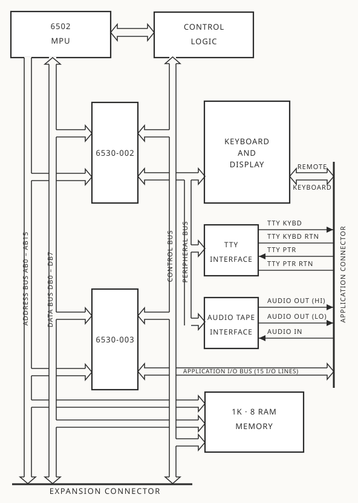
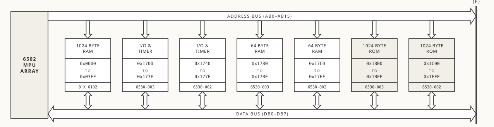
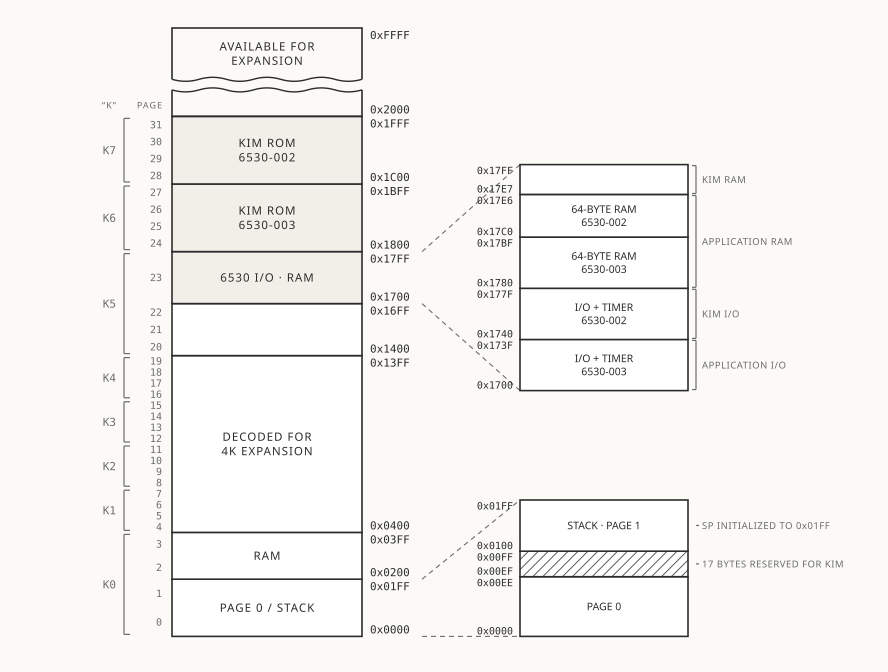

# Chapter 3 - The KIM-1 System

Up to this point you have been engaged in bringing up your KIM-1 system and verifying its correct operation. Now it's time to learn more about the various parts of the KIM-1, how the parts work together as a system, and how the operating programs control the various activities of the system. The diagrams included in this section together with your full sized system schematic will be helpful in understanding the elements of your KIM-1 module.

## KIM-1 System Description

Figure 3-1 shows a complete block diagram of the KIM-1 system. You should note first the presence of the MCS 6502 Microprocessor Array which acts as the central control element for the system. This unit is an 8 bit microprocessor which communicates with other system elements on three separate buses. First, a 16 bit *address* bus permits the 6502 to address directly up to 65,536 memory locations in the system. Next, an 8 bit, bidirectional *data* bus carries data from the 6502 array to any memory location or from any memory location back to the 6502 array. Lastly, a *control* bus carries various timing and control signals between the 6502 array and other system elements.

Associated with the 6502 array is a 1 MHz crystal which operates with an oscillator circuit contained on the 6502 array. This crystal controlled oscillator is the basic timing source from which all other system timing signals are derived. In particular, the Φ2 (PHI2) signal generated by the 6502 array and used either alone, or gated with other control signals, is used as the system time base by all other system elements.

The 6502 microprocessor is structured to work in conjunction with various types of memory. In the KIM-1 system, all memory may be consid­ered to be of the Read-only (ROM) or Read/Write (RAM) variety. The ROM portion of the memory provides permanent storage for the operating progams essential to the control of the KIM-1 system. You will note the inclusion of two devices, labelled 6530-002 and 6530-003. Each of these devices include a 1024 byte (8 bits per byte) ROM with different portions of the operating program stored permanently in each ROM.

RAM type memory is available at three locations in the system. Again, each of the 6530 arrays include 64 bytes of RAM primarily used for temporary data storage in support of the operating program. In addition, a separate 1024 byte RAM is included in the KIM-1 system and provides memory storage for user defined application programs and data.

Input/output controls for the system also are included within the 6530 arrays. Each 6530 array provides 15 I/O pins with the microprocessor and operating program defining whether each pin is an input pin or output pin, what data is to appear on the output pins, and reading the data appear­ ing on input pins. The I/O pins provided on the 6530-002 are dedicated to interfacing with specific elements of the KIM-1 system including the key­ board, display, TTY interface circuit, and audio tape interface circuit. The 15 I/O pins on the 6530-003 are brought to a connector and are avail­ able for the user to control a specific application.

Finally, each 6530 array includes an interval timer capable of count­ ing a specific number of system clocks to generate precise timing gates. 
The exact time interval is preset under program control. The interval timer on the 6530-003 array is available for a user defined application program and is not required by the operating programs.

Figure 3-1 shows a major block labelled Control Logic. Included under this category are an address decoder used for generation of chip select signals for the 6530 arrays and the static RAM. Also included is the logic required to debounce the keys for system reset (RS key) and pro­gram stop (ST key). Lastly, special logic is included to allow operation of the system in a "single instruction" mode to facilitate program de­bugging.

Figure 3-1 shows the keyboard/display logic interfacing with the I/O pins of the 6530-002. Also shown are the interface circuits for trans­
mission of data to and reception of data from the TTY and audio tape units.

<figure markdown="span">
  
  <figcaption>Figure 3.11 KIM-1 Block Diagram</figcaption>
</figure>

Figure 3-2 shows the detailed interconnections between the MCS 6502 and the two MCS 6530 arrays.

Figure 3-3 shows detailed logic and schematics for the control logic. Figure 3-4 shows a detailed schematic of the static RAM.

Figure 3-5 and 3-6 show the detailed schematic of the keyboard and display logic and circuits.

Figure 3-7 details the schematic of the TTY interface circuits.

Figure 3-8 details the schematic of the audio tape cassette interface circuits.

The following signals are available on the Application Connector:

| Pin Number | Signal | Pin Number | Signal |
|---|---|:---:|---|
| 22 | KB Col D | Z | KB Row 1 |
| 21 | KB Col A | Y | KB Col C |
| 20 | KB Col E | X | KB Row 2 |
| 19 | KB Col B | W | KB Col G |
| 18 | KB Col F | V | KB Row 3 |
| 17 | KB Row 0 | U | TTY PTR |
| 16 | PB5 | T | TTY KYBD |
| 15 | PB7 | S | TTY PTR RTRN(+) |
| 14 | PA0 | R | TTY KYBD RTRN(+) |
| 13 | PB4 | P | AUDIO OUT HI |
| 12 | PB3 | N | +12V |
| 11 | PB2 | M | AUDIO OUT LO |
| 10 | PB1 | L | AUDIO IN |
| 9 | PB0 | K | DECODE ENAB |
| 8 | PA7 | J | K7 |
| 7 | PA6 | H | K5 |
| 6 | PA5 | F | K4 |
| 5 | PA4 | E | K3 |
| 4 | PA1 | D | K2 |
| 3 | PA2 | C | K1 |
| 2 | PA3 | B | K0 |
| 1 | GND | A | VCC +5V |

The following signals are available on the Expansion Connector:

| Pin Number | Signal | Pin Number | Signal |
|---|---|:---:|---|
| 22 | KB Col D | Z | KB Row 1 |
| 21 | KB Col A | Y | KB Col C |
| 20 | KB Col E | X | KB Row 2 |
| 19 | KB Col B | W | KB Col G |
| 18 | KB Col F | V | KB Row 3 |
| 17 | KB Row 0 | U | TTY PTR |
| 16 | PB5 | T | TTY KYBD |
| 15 | PB7 | S | TTY PTR RTRN(+) |
| 14 | PA0 | R | TTY KYBD RTRN(+) |
| 13 | PB4 | P | AUDIO OUT HI |
| 12 | PB3 | N | +12V |
| 11 | PB2 | M | AUDIO OUT LO |
| 10 | PB1 | L | AUDIO IN |
| 9 | PB0 | K | DECODE ENAB |
| 8 | PA7 | J | K7 |
| 7 | PA6 | H | K5 |
| 6 | PA5 | F | K4 |
| 5 | PA4 | E | K3 |
| 4 | PA1 | D | K2 |
| 3 | PA2 | C | K1 |
| 2 | PA3 | B | K0 |
| 1 | GND | A | VCC +5V |

The fold-out system schematic shows all of the elements of the system connected together and all signals appearing on the module connectors.

You may refer to the Hardware Manual included with your KIM-1 module for additional details on the operating characteristics of the 6502 and 6530 arrays as well as detailed information on system timing.

**TODO: Insert link to schematics on GitHub Repo**

*NOTE:* You can also download the schematics from the GitHub repo.

**TODO: Insert Figure 3.1-3.8 here**

## KIM-1 Memory Allocation

It has been stated that the 6502 microprocessor array included in the KIM-1 system is capable of addressing any of 65,536 memory locations. Obviously, we have not included that much memory in your KIM-1 system and this section is intended to detail for you exactly what memory locations are included in the system and where they are located (their exact addresses).

Each byte of memory in the system is understood to include 8 bits. Also, you should note that any addressable location in the system may be performing any one of four functions:

1. A ROM byte - read-only memory in which we have stored the operating program.  
2. A RAM byte - read/write memory for storage of variable data.  
3. An I/O location - these locations include both direction registers which define the I/O pins to be either input pins or output pins, and the actual data buffer locations containing the data to be transmitted on output pins or the data read from input pins. Any I/O location may be viewed as a read/write memory location with a specific address.  
4. An Interval Timer location - a series of addresses are reserved for each interval timer in the system. Again, you may write to the timer to define its counting period or read from the timer to determine its exact state.

Figure 3-11 shows a block diagram detailing all memory blocks in the KIM-1 system. Figure 3-12 provides a memory map showing all addressable locations included in the system and their relationship to each other. Note also the areas in the memory map indicated as available for expansion (Section 6 of the manual provides more detail on the subject of memory expansion). Finally, Figure 3-13 provides a complete listing of all important memory locations and will be referenced frequently by you when writing your application programs.

Referring to Figure 3-12, note that the memory map shows a block of 8192 address locations all existing in the lowest address space within the possible 65,536 address locations. This address space is further divided into eight blocks of 1024 locations each. Each 1024 block is further divided into four pages of 256 locations each. The "K" reference defines a specific block of 1024 locations and refers to the "K" number of the address decoder included within the system control logic. The "page" reference defines a specific group of 256 addresses. A total of 32 pages (0 to 31) are included in the 8192 address locations. The hex codes for certain addresses are shown at strategic locations in the memory map.

Beginning from the highest address location of the 8192, note that the first 1024 block (K7) is assigned to the ROM of the 6530-002 and the second 1024 block (K6) is assigned to the ROM of the 6530-003. The entire operating program of the KIM-1 system is included in these two blocks.

Next in order, a portion of the K5 block is dedicated to the RAM, I/O, and Timer locations of the two 6530 arrays. An expanded view of this address space is shown in Figure 3-12. Note that the RAM addresses for the 6530-002 (Hex 17EC to 17FF) are reserved for use by the operating program and should not appear in a user generated application program. The same is true for the I/O and Timer locations of the 6530-002 which also are reserved for use by the operating programs.

The next four blocks in order (K4, K3, K2 , Kl) are reserved for additional memory in an expanded system. In Section 6, the methods for adding memory will be discussed.

Finally, the lowest 1024 address locations (KO) are assigned to the static RAM included within the KIM-1 system. You should note that within this block. Page and Page 1 have special significance. Page 1 is used as the system stack onto which return addresses and machine status words are pushed as the system responds to interrupts and subroutine commands. Page has significance for certain of the special addressing modes available when programming for the 6502 microprocessor array.

Figure 3-12 shows an expanded view of Page and Page 1. Note that 17 addresses (OOEF to OOFF) are reserved for use by the operating program and must never appear in the user generated application program. Also, note the comment that a maximum of eight locations may be required on the stack (Page 1) to service operating program interrupts.

In summary, the user generated application program may make use of the following areas of memory:

1. All of Page except OOEF to OOFF  
2. All of Page 1 (remember that the stack will extend an extra 8 bytes deep to accommodate the operating program).  
3. All of Page 2 and Page 3.  
4. In Page 23:
    - All I/O locations from 1700 to 173F
    - All 64 bytes of RAM from 1780 to 17BF
    - An additional 44 bytes of RAM from 17C0 to 17EB

<figure markdown="span">
  
  <figcaption>Figure 3.11 KIM-1 Memory Block Diagram</figcaption>
</figure>

<figure markdown="span">
  
  <figcaption>Figure 3.12 KIM-1 Memory Map</figcaption>
</figure>

### KIM-1 Special Memory Addresses
<table>

  <tr>
    <strong><td>ADDRESS</td><td>AREA</td><td>LABEL</td><td>FUNCTION</td></strong>
  </tr>
  <tr>
    <td>0x00EF</td><td rowspan="7">Machine Register Storage Buffer</td><td>PCL</td><td>Program Counter - Low Order Byte</td>
  </tr>
  <tr>
    <td>0x00F0</td><td>PCH</td><td>Program Counter - High Order Byte</td>
  </tr>
  <tr>
    <td>0x00F1</td><td>P</td><td>Status Register</td>
  </tr>
  <tr>
    <td>0x00F2</td><td>SP</td><td>Stack Pointer</td>
  </tr>
  <tr>
    <td>0x00F3</td><td>A</td><td>Accumulator</td>
  </tr>
  <tr>
    <td>0x00F4</td><td>Y</td><td>Y-Index Register</td>
  </tr>
  <tr>
    <td>0x00F5</td><td>X</td><td>X-Index Register</td>
  </tr>

  <tr>
    <td>0x1700</td><td rowspan="4">Application I/O</td><td>PAD</td><td>6530-003 A Data Register</td>
  </tr>
  <tr>
    <td>0x1701</td><td>PADD</td><td>6530-003 A Data Direction Register</td>
  </tr>
  <tr>
    <td>0x1702</td><td>PBD</td><td>6530-003 B Data Register</td>
  </tr>
  <tr>
    <td>0x1703</td><td>PBDD</td><td>6530-003 B Data Direction Register</td>
  </tr>

  <tr>
    <td>0x1704</td><td rowspan="3">Interval Timer</td><td rowspan="3"></td><td rowspan="3">6530-003 Interval Timer   (See Section 1.6 of Hardware Manual)</td>
  </tr>
  <tr>
    <td>TO</td>
  </tr>
  <tr>
    <td>0x170F</td>
  </tr>

  <tr>
    <td>0x17F5</td><td rowspan="5">Audio Tape Load & Dump</td><td>SAL</td><td>Starting Address - Low Order Byte</td>
  </tr>
  <tr>
    <td>0x17F6</td><td>SAH</td><td>Program Counter - High Order Byte</td>
  </tr>
  <tr>
    <td>0x17F7</td><td>EAL</td><td>Ending Address - Low Order Byte</td>
  </tr>
  <tr>
    <td>0x17F8</td><td>EAH</td><td>Ending Address - High Order Byte</td>
  </tr>
  <tr>
    <td>0x17F9</td><td>ID</td><td>File Identification Number</td>
  </tr>

  <tr>
    <td>0x17FA</td><td rowspan="6">Interrupt Vectors</td><td>NMIL</td><td>NMI Vector - Low Order Byte</td>
  </tr>
  <tr>
    <td>0x17FB</td><td>NMIH</td><td>NMI Vector- High Order Byte</td>
  </tr>
  <tr>
    <td>0x17FC</td><td>RSTL</td><td>RST Vector - Low Order Byte</td>
  </tr>
  <tr>
    <td>0x17FD</td><td>RSTH</td><td>RST Vector - High Order Byte</td>
  </tr>
  <tr>
    <td>0x17FE</td><td>IRQL</td><td>IRQ Vector - Low Order Byte</td>
  </tr>
  <tr>
    <td>0x17FF</td><td>IRQH</td><td>IRQ Vector - Highow Order Byte</td>
  </tr>

</table>

## KIM-1 Operating Programs

Figure 3-14 shows a simplified flow chart of the KIM-1 operating programs. This section provides a brief explanation of these programs to assist you in understanding the various operating modes of the system.

First, you should note that when power is first applied to your KIM-1 module and the `RS` (Reset) key is depressed, control of the system automatically is assumed by the operating program. This is true, as well, for any succeeding depression of the reset key.

For each depression of the reset key, the system is initialized. At this time, stack pointer values are set, the I/O configuration is established, and essential status flags are conditioned. Next the program determines whether the system is to respond to TTY inputs or is to operate with the keyboard and display on the KIM-1 module.

If the TTY mode has been selected, the program halts and awaits a first key depression from the TTY (the RubOut Key) . Upon receipt of this key depression, the program automatically performs a bit rate measurement and stores the correct value for use in receiving and decoding succeeding data transfers from the TTY. Note that this bit rate measurement is performed after each depression of the reset key.

The program will proceed immediately to a routine causing the prompting message ("KIM") to be typed on the TTY. Now, the program halts at the loop called "Get Character". As each key is depressed on the TTY, the coded data is accepted and analyzed in the routine called "Execute Key". The various keys depressed will cause the program to branch to the appropriate subroutines required to perform the desired operation. Upon completion of the individual key executions, the program returns to the "Get Key" loop and awaits the next key depression.

**TODO: Insert figure 3.14**

Exit from the TTY processing loop will occur in response to:

1. A depression of the reset key,  
2. A depression of the G key which initiates execution of the application program, or  
3. A change in the mode from TTY to Keyboard/Display.

If, after system reset and initialization, the Keyboard/Display mode (KB) is determined to be in effect, the program will proceed directly to display, and keyboard scan routines. The program will cause the display scan to occur continuously ("Display Cell") until one of the keys on the keyboard is depressed (AK?) . Key validation is performed during an additional scan cycle. If the key is truly depressed (not noise), the program proceeds to the routine called "Get Key" in which the exact key depressed is defined. Next, the program moves to the "Execute Key" routine where branches to appropriate execution routines will be performed. Finally, after key execution, the program returns to the "Display Cell" routine and waits for the key to be released. When no key is depressed, the program returns to the normal "Display Cell" routine and awaits the next key depression.

In either the TTY or KB modes, the audio tape load or dump routines may be executed using appropriate commands from the selected keyboards. In either case, completion of the tape load or dump routine allows the program to return to the "Start" position which will, as usual, activate the KIM-1 display or cause the "KIM" prompting message on the TTY. You should note the use of the Stop key to activate the non-maskable interrupt input (NMI) of the 6502 microprocessor array. Depression of this key causes an unconditional termination of program execution, a saving of machine status registers on the stack, and a return to the control of the operating program.

A second interrupt input is available and referred to as IRQ. This interrupt may be defined by the user and will cause the program to jump to any location defined by the user in his program. 
